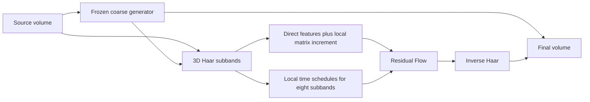

# SAWR-Flow: Spatially Adaptive Wavelet Residual Flow for 3D Cross-Modal Medical Image Synthesis

SAWR-Flow synthesizes a target medical volume in two stages. A frozen latent Flow generates a coarse target. A second Flow predicts a 3D Haar residual using spatial cross-modal subband coupling and local transport schedules for all eight subbands, including LLL.

The default release configuration is **eight-band MRI→CT**. It preserves direct concatenation of the source and coarse target as a conditioning path. A learned local matrix adds conditioning features, and a separate bounded schedule head determines the timing of updates in each subband. The residual endpoint is supervised by the difference between the target and the coarse target.



## Setup

Use Python 3.10 or later and a PyTorch 2.10 build compatible with your CUDA installation. The full-resolution training configurations use BF16 on one CUDA device per run.

```bash
python -m pip install -r requirements.txt
python -m unittest discover -s tests
python scripts/smoke_sawr.py
```

The synthetic smoke test runs training, exact checkpoint resume, held-out evaluation, and source-only NIfTI inference on CPU.

## Data format

Prepare aligned 3D NIfTI pairs on the same grid. The example CSV header uses the input field names expected by both training stages. For CT tasks, `t1_path` points to MRI or CBCT, and `fdg_pet_path` points to the normalized CT target. `has_fdg_pet` indicates whether the row has a paired target.

```csv
subject_id,sample_id,t1_path,fdg_pet_path,has_fdg_pet,split,fold,source_mask_path,evaluation_mask_path
subject_001,scan_001,mri/001.nii.gz,ct/001.nii.gz,True,train,1,fov/001.nii.gz,outline/001.nii.gz
subject_002,scan_002,mri/002.nii.gz,ct/002.nii.gz,True,train,0,fov/002.nii.gz,outline/002.nii.gz
subject_003,scan_003,mri/003.nii.gz,ct/003.nii.gz,True,final_val,-1,fov/003.nii.gz,outline/003.nii.gz
```

- Paths are relative to `--dataset-root`. Training uses `train` with a nonzero fold, validation uses `train` with fold 0, and testing uses `final_val`. Keep subjects disjoint between the partitions.
- Source and target intensities must be within `[-1, 1]`. The CT configuration assumes clipping to `[-1024, 3000]` HU before mapping to `[-1, 1]`.
- CT generation requires a registered binary source FOV mask. The patient outline is optional and only used for masked evaluation. MRI→PET uses MRI-derived support and can omit both mask columns.

## Train MRI→CT

Train the coarse generator or supply a compatible frozen anchor from the same modality, normalization and grid.

```bash
CUDA_VISIBLE_DEVICES=0 python train.py \
  --cohort SynthRAD2023-MRI2CT --config configs/anchor_ct.json \
  --metadata data/split.csv --dataset-root data \
  --run-dir runs/anchor --anchor-only
```

Train the eight-band SAWR residual. The default configuration uses seed 42, a fixed budget of 15 epochs, and two Euler steps.

```bash
CUDA_VISIBLE_DEVICES=0 python train_sawr.py \
  --config configs/sawr_mri2ct.json \
  --metadata data/split.csv --dataset-root data \
  --anchor runs/anchor/frozen/fold_0/flow/best.pt \
  --tensor-cache runs/cache/pairs --anchor-cache runs/cache/anchors \
  --run-dir runs/sawr
```

Add `--resume` to the same command to continue from `last.pt`. Training saves `best.pt` by validation MAE and `last.pt` at each epoch boundary.

`configs/sawr_mri2pet.json` and `configs/sawr_cbct2ct.json` provide eight-band configurations for those modalities. They are starting configurations for new experiments.

## Inference and evaluation

```bash
CUDA_VISIBLE_DEVICES=0 python inference_sawr.py \
  --source data/mri/003.nii.gz --source-mask data/fov/003.nii.gz \
  --anchor runs/anchor/frozen/fold_0/flow/best.pt \
  --checkpoint runs/sawr/last.pt --output runs/generated_ct.nii.gz

CUDA_VISIBLE_DEVICES=0 python evaluate_sawr.py \
  --metadata data/split.csv --dataset-root data \
  --anchor runs/anchor/frozen/fold_0/flow/best.pt \
  --checkpoint runs/sawr/last.pt --partition test --full-volume \
  --output-dir runs/evaluation
```

CT inference writes a NIfTI in HU and a JSON sidecar with the model and anchor hashes. Full-volume evaluation includes all voxels and all Haar blocks. It saves per-scan, per-subject and aggregate results, including CT MAE in HU and the eight subband MAEs. Run `python scripts/compare_ct_full_volume.py --help` for the paired comparison using the supplied ablation configurations.


## Compatibility

The `train_sawr.py`, `inference_sawr.py`, and `evaluate_sawr.py` entry points use the existing implementation. The internal `ucf` package, checkpoint format, and parameter names are unchanged. Existing scripts and `cst_` configurations remain available; the corresponding `sawr_` configurations contain identical settings.
