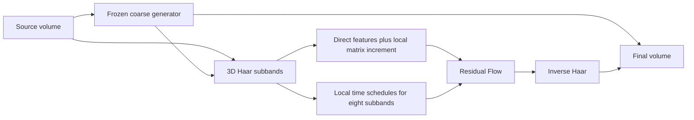

# CST-Flow

CST-Flow synthesizes a target medical volume in two stages. A frozen latent Flow generates a coarse target. A second Flow predicts a 3D Haar residual using spatial cross-modal subband coupling and local transport schedules for all eight subbands, including LLL.

The default release configuration is **eight-band MRI→CT**. It preserves direct concatenation of the source and coarse target as a conditioning path. A learned local matrix adds conditioning features, and a separate bounded schedule head determines the timing of updates in each subband. The residual endpoint is supervised by the difference between the target and the coarse target.



## Setup

Use Python 3.10 or later and a PyTorch 2.10 build compatible with your CUDA installation. The full-resolution training configurations use BF16 on one CUDA device per run.

```bash
python -m pip install -r requirements.txt
python -m unittest discover -s tests
python scripts/smoke_ucf.py
```

The synthetic smoke test runs training, exact checkpoint resume, held-out evaluation, and source-only NIfTI inference on CPU.

## Data format

Prepare aligned 3D NIfTI pairs on the same grid. The example CSV header uses the input field names expected by both training stages. For CT tasks, `t1_path` points to MRI or CBCT, and `fdg_pet_path` points to the normalized CT target. `has_fdg_pet` indicates whether the row has a paired target.

```csv
subject_id,sample_id,t1_path,fdg_pet_path,has_fdg_pet,split,fold,source_mask_path,evaluation_mask_path
subject_001,scan_001,mri/001.nii.gz,ct/001.nii.gz,True,train,1,fov/001.nii.gz,outline/001.nii.gz
subject_002,scan_002,mri/002.nii.gz,ct/002.nii.gz,True,train,0,fov/002.nii.gz,outline/002.nii.gz
subject_003,scan_003,mri/003.nii.gz,ct/003.nii.gz,True,final_val,-1,fov/003.nii.gz,outline/003.nii.gz
```

- Paths are relative to `--dataset-root`. Training uses `train` with a nonzero fold, validation uses `train` with fold 0, and testing uses `final_val`. Keep subjects disjoint between the partitions.
- Source and target intensities must be within `[-1, 1]`. The CT configuration assumes clipping to `[-1024, 3000]` HU before mapping to `[-1, 1]`.
- CT generation requires a registered binary source FOV mask. The patient outline is optional and only used for masked evaluation. MRI→PET uses MRI-derived support and can omit both mask columns.

## Train MRI→CT

Train the coarse generator or supply a compatible frozen anchor from the same modality, normalization and grid.

```bash
CUDA_VISIBLE_DEVICES=0 python train.py \
  --cohort SynthRAD2023-MRI2CT --config configs/anchor_ct.json \
  --metadata data/split.csv --dataset-root data \
  --run-dir runs/anchor --anchor-only
```

Train the eight-band CST residual. The default configuration uses seed 42, a fixed budget of 15 epochs, and two Euler steps.

```bash
CUDA_VISIBLE_DEVICES=0 python train_ucf.py \
  --config configs/cst_mri2ct.json \
  --metadata data/split.csv --dataset-root data \
  --anchor runs/anchor/frozen/fold_0/flow/best.pt \
  --tensor-cache runs/cache/pairs --anchor-cache runs/cache/anchors \
  --run-dir runs/cst
```

Add `--resume` to the same command to continue from `last.pt`. Training saves `best.pt` by validation MAE and `last.pt` at each epoch boundary. Use the fixed-epoch `last.pt` for the comparisons below.

`configs/cst_mri2pet.json` and `configs/cst_cbct2ct.json` provide eight-band configurations for those modalities. They are starting configurations for new experiments. The eight-band results below are for MRI→CT.

## Inference and evaluation

```bash
CUDA_VISIBLE_DEVICES=0 python inference_ucf.py \
  --source data/mri/003.nii.gz --source-mask data/fov/003.nii.gz \
  --anchor runs/anchor/frozen/fold_0/flow/best.pt \
  --checkpoint runs/cst/last.pt --output runs/generated_ct.nii.gz

CUDA_VISIBLE_DEVICES=0 python evaluate_ucf.py \
  --metadata data/split.csv --dataset-root data \
  --anchor runs/anchor/frozen/fold_0/flow/best.pt \
  --checkpoint runs/cst/last.pt --partition test --full-volume \
  --output-dir runs/evaluation
```

CT inference writes a NIfTI in HU and a JSON sidecar with the model and anchor hashes. Full-volume evaluation includes all voxels and all Haar blocks. It saves per-scan, per-subject and aggregate results, including CT MAE in HU and the eight subband MAEs. Run `python scripts/compare_ct_full_volume.py --help` for the paired comparison using the supplied ablation configurations.

## MRI→CT reference results

All rows use the same 18 held-out SynthRAD cases and frozen CT anchor. Residual comparisons use seed 42, epoch 15, and two Euler steps. HHH is reported in normalized Haar coefficient units × 1,000.

| Method | Full MAE ↓ (HU) | PSNR ↑ (dB) | SSIM ↑ | HHH MAE ↓ |
|---|---:|---:|---:|---:|
| Coarse CT | 57.31 | 28.118 | 0.88458 | 3.806 |
| [Original residual Flow](https://github.com/Ednaqvq/mri-pet-wavelet-flow), adapted to CT | 47.99 | 29.409 | 0.90458 | 3.784 |
| Direct concatenation with linear Flow | 47.83 | 29.399 | 0.90384 | 3.772 |
| CST-Flow with seven-band scheduling | 47.66 | 29.451 | 0.90418 | **3.756** |
| CST-Flow with eight-band scheduling | **46.83** | **29.468** | **0.90507** | 3.791 |

Eight-band scheduling reduced the mean full-volume MAE by 0.83 HU relative to seven-band scheduling and improved seven subbands. Seven-band scheduling had the lowest HHH error on this split.

## Detail refinement

`configs/cst_mri2ct_detail_finetune.json` adds eight refinement epochs to a trained MRI-to-CT model. It supervises signed high-frequency residual endpoints, terminal estimates made from the model's own rollout states, CT bone neighbourhoods, and signed CT gradients at strong reference edges. Training thresholds are 300 HU for bone and 200 HU per voxel for strong edges. Target CT is used for supervision and evaluation.

```bash
CUDA_VISIBLE_DEVICES=0 python train_ucf.py \
  --config configs/cst_mri2ct_detail_finetune.json \
  --metadata data/split.csv --dataset-root data \
  --anchor runs/anchor/frozen/fold_0/flow/best.pt \
  --init-checkpoint runs/cst/last.pt \
  --tensor-cache runs/cache/pairs --anchor-cache runs/cache/anchors \
  --run-dir runs/cst_detail
```

Initialization verifies the model configuration, frozen anchor, and training/validation subjects, and retains the training-only normalization statistics. Refinement creates a fresh optimizer. Add `--resume` to continue the same refinement run. Use `runs/cst_detail/last.pt` with the inference and evaluation commands above. Deployment still uses two Euler steps.

Two bone/edge weights, 0.15 and 0.30, were compared on the 18-case validation set. The selected weight, 0.30, had the lower edge-gradient error while satisfying the predefined full-MAE, bone, edge and high-band error checks. This selected candidate was then evaluated on the 18 held-out cases.

| Model | Full MAE ↓ (HU) | Bone MAE ↓ (HU) | Strong-edge MAE ↓ (HU) | Edge gradient / reference ↑ |
|---|---:|---:|---:|---:|
| Original 15-epoch CST | 46.83 | 335.28 | 275.87 | 0.443 |
| Same additional epochs with original losses | **45.25** | 307.29 | 265.46 | 0.477 |
| Structure-supervised refinement | 45.71 | **289.60** | **262.86** | **0.521** |

Bone metrics use reference CT above 300 HU within the eroded patient outline. Evaluation edges are the strongest 15% of reference gradients within that outline. Relative to matched continued training, refinement reduced bone MAE by 17.70 HU and edge-gradient error by 12.96 HU/mm, with full MAE higher by 0.46 HU. Fine skull and sinus structures still show incomplete recovery.
